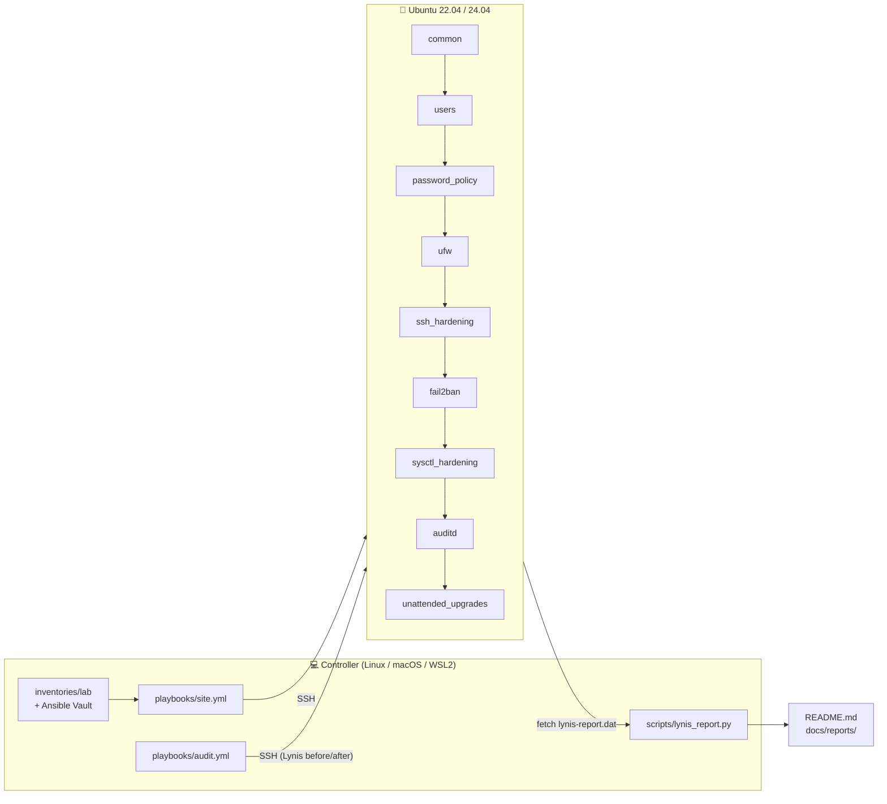
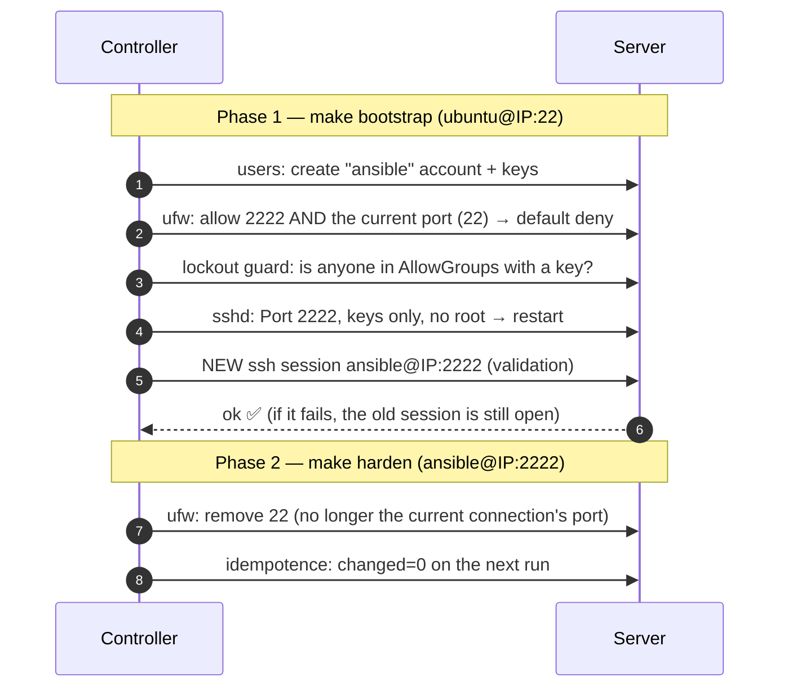

<div align="center">

# 🛡️ server-hardening-kit

**Automated, measurable hardening of Ubuntu servers with Ansible, mapped to the CIS Benchmark.**

[](https://github.com/caiodassumpcao/server-hardening-kit/actions/workflows/ci.yml)
[](https://github.com/caiodassumpcao/server-hardening-kit/actions/workflows/e2e-lynis.yml)


[](LICENSE)

[🇧🇷 Português](README.md) | **🇺🇸 English**

[Quick start](#-quick-start) · [Full guide (PT-BR)](docs/GUIA.md) · [CIS matrix](docs/CIS_MAPPING.md) · [Decisions](docs/DECISIONS.md)

</div>

The kit takes a stock Ubuntu install to a **verifiable** security baseline,
with three guarantees:

1. **It measures before and after.** Lynis audits the server before and after
   hardening, and the score is published in the README.
2. **It reports drift without changing anything.** In audit mode (`--check`)
   every non-compliant control shows up as a failure in a JUnit report.
3. **It won't lock you out.** The SSH port change runs in two phases, with a
   *lockout guard* and access validation from the controller.

---

## 📑 Contents

- [In 30 seconds](#-in-30-seconds)
- [Results](#-results)
- [What gets applied](#-what-gets-applied)
- [How it works](#-how-it-works)
- [Quick start](#-quick-start)
- [Day-to-day usage](#-day-to-day-usage)
- [Configuration](#️-configuration)
- [Testing and quality](#-testing-and-quality)
- [Security decisions](#️-security-decisions)
- [Documentation](#-documentation)
- [Roadmap](#️-roadmap) · [Contributing](#-contributing) · [License](#-license)

---

## 🎯 In 30 seconds

| | |
|---|---|
| **Problem** | A fresh Ubuntu install accepts password logins and has no firewall or auditing. Hardening it by hand is slow, error-prone and hard to prove. |
| **Solution** | One command (`make harden`) applies **CIS Benchmark** controls to one or many servers, idempotently, and **Lynis** measures the security gain before/after. |
| **Stack** | Ansible · Ubuntu 22.04/24.04 · Molecule + Docker · GitHub Actions · Python (pytest) · Lynis · UFW · fail2ban · auditd · AppArmor |
| **Quality** | ansible-lint `production` profile with 0 failures · Molecule on Ubuntu 22.04 and 24.04 (converge, idempotence and verify) · pytest · E2E with Lynis on a real VM in CI |

**What this project demonstrates**

- **Infrastructure as code:** 10 reusable Ansible roles, configurable through variables, with secrets in Ansible Vault.
- **Applied security:** every control traces back to its CIS item, its Lynis test and the MITRE ATT&CK technique it mitigates ([matrix](docs/CIS_MAPPING.md), [threat model](docs/THREAT_MODEL.md)).
- **Safe changes in production:** an audit mode that only reports, and a two-phase SSH port migration that never locks the operator out.
- **Infrastructure testing:** a full test pyramid (lint → unit → integration in containers → E2E on a VM) running on GitHub Actions.
- **Documented decisions:** every trade-off recorded as an ADR ([DECISIONS.md](docs/DECISIONS.md)).

---

## 📊 Results

Lynis hardening index before and after hardening, **generated** by `make report`
(not written by hand) and kept in sync with the [Portuguese README](README.md#-resultados).
The same flow runs weekly on Ubuntu 22.04/24.04 VMs in the
[E2E Lynis](.github/workflows/e2e-lynis.yml) workflow; each run's *Summary*
shows the before/after table.

Detailed report (resolved and remaining warnings/suggestions):
[`docs/reports/lynis-comparison.md`](docs/reports/lynis-comparison.md).

> **Why not 100?** Some Lynis tests depend on infrastructure decisions a generic
> kit shouldn't make on its own (separate partitions, GRUB password, AIDE,
> antivirus). They are listed under
> [Out of scope](docs/CIS_MAPPING.md#fora-de-escopo-decisão-consciente).

---

## ✅ What gets applied

| Role | What it does | CIS (Ubuntu 24.04 v1.0.0) |
|---|---|---|
| [`common`](roles/common) | Validates the OS, waits for cloud-init, removes legacy clients (telnet/rsh/nis), disables rare kernel modules and USB storage, restricts core dumps, enables AppArmor and a login banner | 1.1.1.x, 1.3, 1.5.3, 1.6, 2.2.x, 3.2.x |
| [`users`](roles/users) | Admins with **password-protected** sudo, key-only automation account, **restricted sudo** via command allowlist, `su` blocked, exclusive `authorized_keys`, NOPASSWD audit | 5.2.1–5.2.7 |
| [`password_policy`](roles/password_policy) | Local and sudo passwords: `pam_pwquality` (14+ chars, 4 classes), 365-day expiry, yescrypt hashing, `umask 027` | 5.3.1.3, 5.3.3.2.x, 5.4.1.x, 5.4.3.3 |
| [`ufw`](roles/ufw) | Default deny, loopback anti-spoofing, SSH rate limiting, port change without lockout | 4.1.1–4.1.7 |
| [`ssh_hardening`](roles/ssh_hardening) | Keys only, no root, configurable port, `AllowGroups`, modern crypto (including hybrid post-quantum KEX), moduli ≥ 3072 bits | 5.1.1–5.1.22 |
| [`fail2ban`](roles/fail2ban) | `sshd` jail (aggressive, journald) with progressive bans + `recidive` jail, banning through ufw | defense in depth |
| [`unattended_upgrades`](roles/unattended_upgrades) | Automatic **security** patches, explicit reboot policy | 1.2.2.1 |
| [`sysctl_hardening`](roles/sysctl_hardening) | ASLR, ptrace, kptr/dmesg, BPF, redirects, rp_filter, SYN cookies… with **runtime drift detection** | 1.5.1–1.5.3, 3.3.1–3.3.11 |
| [`auditd`](roles/auditd) | All CIS 6.2.3 rules generated from data (multi-arch), host-discovered setuid binaries, immutable rules, `audit=1` at boot | 6.2.1–6.2.3 |
| [`lynis`](roles/lynis) | Installs Lynis from the signed official repository, runs the audit and fetches the report | — |

📋 **Full matrix** (control × CIS item × Lynis test × MITRE ATT&CK technique ×
verification command): **[`docs/CIS_MAPPING.md`](docs/CIS_MAPPING.md)**.

---

## 🏗 How it works



**Role order matters.** `ufw` runs *before* `ssh_hardening`, so the new port is
already open when `sshd` restarts. `users` runs before both, so someone with a
key already exists when password login is turned off.

### Two-phase SSH port migration



---

## 🚀 Quick start

> First time? Follow the **[full guide](docs/GUIA.md)** (Portuguese). It explains
> every step, covers Windows (WSL2/Dev Container), cloud or Multipass VMs, and
> what to do if something goes wrong.

**Requirements:** a Linux, macOS or **WSL2** controller with Python 3.11+, `make`
and `git` · an Ubuntu 22.04/24.04 server reachable over SSH with a key and sudo ·
TCP port `2222` open in the cloud provider's firewall.

```bash
# 1. Environment
git clone https://github.com/caiodassumpcao/server-hardening-kit.git && cd server-hardening-kit
make install && source .venv/bin/activate

# 2. Inventory: server IP, your public key and the sudo password hash
make lab-init
$EDITOR inventories/lab/hosts.yml inventories/lab/group_vars/hardening/main.yml
ansible-vault encrypt inventories/lab/group_vars/hardening/vault.yml

# 3. Before hardening, use the stock credentials (BOOTSTRAP=1)
make ping BOOTSTRAP=1            # connectivity
make audit-before BOOTSTRAP=1    # baseline Lynis score
make check BOOTSTRAP=1           # audit only: shows what is out of compliance

# 4. Two-phase hardening
make bootstrap                   # run 1: ubuntu@IP:22 → creates accounts, moves SSH to 2222
make harden                      # run 2: ansible@IP:2222 → closes port 22

# 5. Results
make reboot && make audit-after && make report
```

> On DigitalOcean/Hetzner the initial user is `root`: add `BOOTSTRAP_USER=root`
> to the `BOOTSTRAP=1` commands and to `make bootstrap`.

---

## 🔁 Day-to-day usage

| Goal | Command |
|---|---|
| List all commands | `make help` |
| Audit without changing anything (drift) | `make check` |
| Apply to every host | `make harden` |
| Apply to a single host | `make harden LIMIT=lab-01` |
| Apply a single area | `make harden TAGS=ssh` · `TAGS=ufw` · `TAGS=users` · `TAGS=auditd` |
| Preview a single area | `make check TAGS=sysctl` |
| Pass extra flags to Ansible | `make harden ARGS="-vvv"` |
| Ad-hoc Lynis audit | `make audit-after ARGS="-e lynis_label=2026-11-monthly"` |
| Reboot and wait | `make reboot` |

---

## ⚙️ Configuration

Every variable has a safe default in `roles/<role>/defaults/main.yml`, commented
with its CIS item. Start from [`inventories/example/`](inventories/example). The
most used ones:

| Variable | Default | Description |
|---|---|---|
| `hardening_ssh_port` | `22` (example uses `2222`) | SSH port, shared by `ssh_hardening`, `ufw` and `fail2ban` |
| `hardening_ssh_group` | `sshusers` | The only group allowed over SSH (`AllowGroups`) |
| `hardening_admin_group` | `sysadmins` | Group with full sudo (password required) |
| `hardening_trusted_networks` | `[]` | IPs/CIDRs fail2ban never bans |
| `hardening_reboot` | `false` | Reboot automatically when required |
| `users_admins` | `[]` | Human admins (`name`, `ssh_keys`, `password_hash`) |
| `users_automation` | disabled | Ansible account (`enabled`, `name`, `ssh_keys`, `allowed_from`) |
| `users_restricted` | `[]` | Accounts with limited sudo (`sudo_commands`) |
| `ufw_ssh_allowed_sources` | `[any]` | Allowed SSH sources |
| `ufw_rules` | `[]` | Application firewall rules |
| `sysctl_hardening_ip_forward` | `false` | `true` on Docker/K8s/VPN hosts |
| `auditd_immutable` | `true` | Immutable audit rules until reboot (CIS 6.2.3.20) |

---

## 🧪 Testing and quality

| Layer | Tool | What it guarantees | Local command | CI |
|---|---|---|---|---|
| Static | `yamllint` + `ansible-lint` (**production** profile) | Best practices and FQCN | `make lint` | every push/PR |
| Unit | `pytest` | Lynis report generator | `make test-unit` | every push/PR |
| Integration | **Molecule** + Docker, Ubuntu 22.04 **and** 24.04 | Converge, **idempotence** (`changed=0`) and effective state (`sshd -T`, `sudo -l`, `apt-config dump`…) | `make test` | every push/PR |
| End to end | Real playbook + **Lynis** on a GitHub Actions VM | Idempotence and compliant `--check` on a real VM, before/after score | — | push to `main` + weekly |

---

## ⚖️ Security decisions

| Decision | Accepted trade-off |
|---|---|
| `00-hardening.conf` drop-in instead of rewriting `sshd_config` | Relies on sshd's *first match wins* rule, but survives upgrades and beats `50-cloud-init.conf` |
| SSH socket activation disabled | Differs from the 24.04 default, but keeps one code path for 22.04/24.04 |
| `NOPASSWD` automation account | Exception to CIS 5.2.4, mitigated by key-only access, `from=` and auditd trail |
| Two-phase port migration | Port 22 stays open until the second run, as a way back |
| Immutable auditd + `single` when the disk is full | Audit-trail integrity over availability; changing rules requires a reboot |
| Only **security** patches are automatic, no auto-reboot | New kernels activate on the next planned reboot |
| Non-standard SSH port | **Not** a security control, just less bot noise; the real controls are keys, fail2ban, rate limiting and `AllowGroups` |

Full reasoning in [`docs/DECISIONS.md`](docs/DECISIONS.md) (Portuguese).

---

## 📚 Documentation

| Document | Purpose |
|---|---|
| [`docs/GUIA.md`](docs/GUIA.md) | Full walkthrough, recipes, lockout recovery and troubleshooting (Portuguese) |
| [`docs/CIS_MAPPING.md`](docs/CIS_MAPPING.md) | Control × CIS × Lynis × MITRE ATT&CK × verification command |
| [`docs/DECISIONS.md`](docs/DECISIONS.md) | Architecture decision records |
| [`docs/THREAT_MODEL.md`](docs/THREAT_MODEL.md) | Threat model (STRIDE) and residual risks |
| [`SECURITY.md`](SECURITY.md) | How to report vulnerabilities |
| [`CONTRIBUTING.md`](CONTRIBUTING.md) | How to contribute |

---

## 🗺️ Roadmap

- [ ] Ubuntu 26.04 LTS: validate `sudo-rs`/`uutils`, the defaults since 25.10
- [ ] AIDE (file integrity, CIS 6.3)
- [ ] Log shipping (journald/auditd) to a remote SIEM
- [ ] SSH certificates (OpenSSH CA) instead of `authorized_keys`
- [ ] Cross-check the score with OpenSCAP / CIS-CAT
- [ ] Reproducible lab with Terraform

---

## 🤝 Contributing

Issues and pull requests are welcome. Run `make lint`, `make test-unit` and
`make test` before opening a PR; see [CONTRIBUTING.md](CONTRIBUTING.md). Report
vulnerabilities privately as described in [SECURITY.md](SECURITY.md).

## 📄 License

[MIT](LICENSE)

> ⚠️ **Disclaimer:** this kit changes critical access settings. Test on a
> disposable machine, run `make check` before `make harden` and keep
> out-of-band access. Production use is at the operator's own risk.
