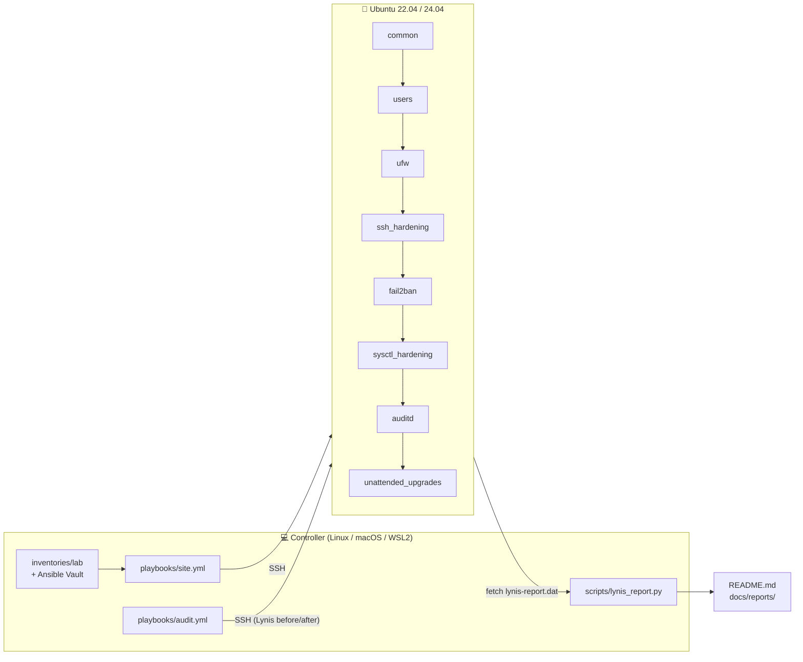
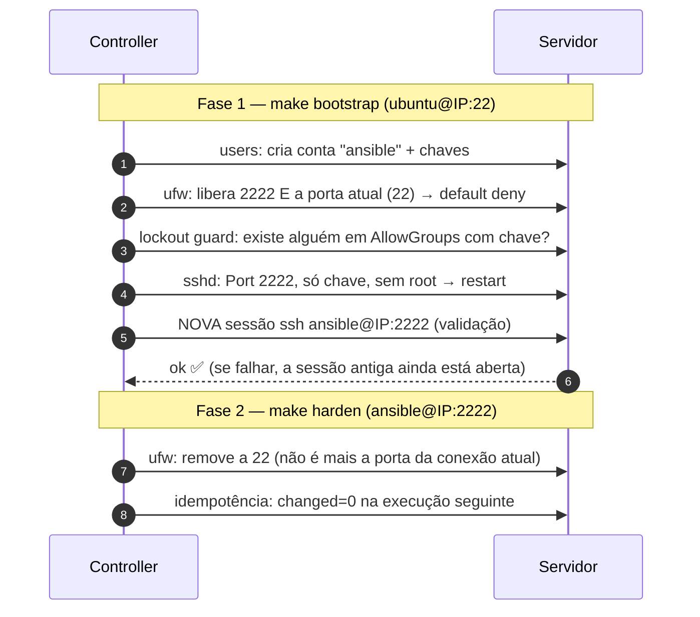

<div align="center">

# 🛡️ server-hardening-kit

**Hardening automatizado e mensurável de servidores Ubuntu com Ansible, mapeado ao CIS Benchmark.**

[](https://github.com/caiodassumpcao/server-hardening-kit/actions/workflows/ci.yml)
[](https://github.com/caiodassumpcao/server-hardening-kit/actions/workflows/e2e-lynis.yml)


[](LICENSE)

**🇧🇷 Português** | [🇺🇸 English](README.en.md)

[Início rápido](#-início-rápido) · [Guia completo](docs/GUIA.md) · [Matriz CIS](docs/CIS_MAPPING.md) · [Decisões](docs/DECISIONS.md)

</div>

O kit pega um Ubuntu "de fábrica" e o leva a um baseline de segurança
**verificável**, com três garantias:

1. **Mede antes e depois.** O Lynis audita o servidor antes e depois do
   hardening, e o score é publicado neste README.
2. **Diz o que está fora do padrão sem mexer em nada.** No modo auditoria
   (`--check`) cada controle não conforme aparece como uma falha em relatório JUnit.
3. **Não te tranca fora do servidor.** A troca de porta do SSH é feita em duas
   fases, com *lockout guard* e validação de acesso a partir do controller.

---

## 📑 Sumário

- [Em 30 segundos](#-em-30-segundos)
- [Resultados](#-resultados)
- [O que é aplicado](#-o-que-é-aplicado)
- [Como funciona](#-como-funciona)
- [Início rápido](#-início-rápido)
- [Uso no dia a dia](#-uso-no-dia-a-dia)
- [Configuração](#️-configuração)
- [Testes e qualidade](#-testes-e-qualidade)
- [Decisões de segurança](#️-decisões-de-segurança)
- [Documentação](#-documentação)
- [Estrutura do repositório](#-estrutura-do-repositório)
- [Roadmap](#️-roadmap) · [Contribuindo](#-contribuindo) · [Licença](#-licença)

---

## 🎯 Em 30 segundos

| | |
|---|---|
| **Problema** | Um Ubuntu recém-instalado aceita login por senha, não tem firewall nem auditoria. Endurecer na mão é lento, sujeito a erro e difícil de provar. |
| **Solução** | Um comando (`make harden`) aplica controles do **CIS Benchmark** em um ou vários servidores, de forma idempotente, e o **Lynis** mede o ganho de segurança antes/depois. |
| **Stack** | Ansible · Ubuntu 22.04/24.04 · Molecule + Docker · GitHub Actions · Python (pytest) · Lynis · UFW · fail2ban · auditd · AppArmor |
| **Qualidade** | ansible-lint perfil `production` com 0 falhas · Molecule em Ubuntu 22.04 e 24.04 (converge, idempotência e verify) · pytest · E2E com Lynis em VM real no CI |

**O que este projeto demonstra**

- **Infraestrutura como código:** 9 roles Ansible reutilizáveis, configuráveis por variáveis, com segredos no Ansible Vault.
- **Segurança aplicada:** cada controle é rastreável até o item do CIS, o teste do Lynis e a técnica do MITRE ATT&CK que ele mitiga ([matriz](docs/CIS_MAPPING.md), [modelo de ameaças](docs/THREAT_MODEL.md)).
- **Mudança segura em produção:** modo auditoria que só relata sem alterar nada, e troca de porta SSH em duas fases que não tranca o operador fora do servidor.
- **Testes de infraestrutura:** pirâmide completa (lint → unitário → integração em containers → E2E em VM) rodando no GitHub Actions.
- **Decisões documentadas:** cada trade-off registrado como ADR ([DECISIONS.md](docs/DECISIONS.md)).

---

## 📊 Resultados

Hardening index do Lynis antes e depois do hardening. A tabela é **gerada** pelo
`make report` ([passo 13 do guia](docs/GUIA.md#13-medir-o-resultado-lynis-depois-e-publicar)),
não escrita à mão. O mesmo fluxo roda toda semana em VMs Ubuntu 22.04/24.04 no
workflow [E2E Lynis](.github/workflows/e2e-lynis.yml), e o resultado fica no
*Summary* de cada execução.

<!-- LYNIS:START -->
| Host | SO | Lynis | Score antes | Score depois | Δ | Warnings | Sugestões |
|---|---|---|:-:|:-:|:-:|:-:|:-:|
| _execute o passo a passo e rode `make report`_ | — | — | — | — | — | — | — |
<!-- LYNIS:END -->

Relatório detalhado (warnings e sugestões resolvidos e remanescentes):
[`docs/reports/lynis-comparison.md`](docs/reports/lynis-comparison.md).

> **Por que não 100?** Alguns testes do Lynis dependem de decisões de
> infraestrutura que um kit genérico não deve tomar sozinho (partições separadas,
> senha de GRUB, AIDE, antivírus). Estão listados em
> [Fora de escopo](docs/CIS_MAPPING.md#fora-de-escopo-decisão-consciente).

---

## ✅ O que é aplicado

| Role | O que faz | CIS (Ubuntu 24.04 v1.0.0) |
|---|---|---|
| [`common`](roles/common) | Valida o SO, espera o cloud-init, remove clientes legados (telnet/rsh/nis), desabilita módulos de kernel raros e USB storage, restringe core dumps, ativa AppArmor e banner | 1.1.1.x, 1.3, 1.5.3, 1.6, 2.2.x, 3.2.x |
| [`users`](roles/users) | Admins com sudo **com senha**, conta de automação só com chave, **sudo restrito** por allowlist de comandos, `su` bloqueado, `authorized_keys` exclusivo, auditoria de NOPASSWD | 5.2.1–5.2.7 |
| [`ufw`](roles/ufw) | Default deny, loopback anti-spoofing, rate limit no SSH, troca de porta sem lockout | 4.1.1–4.1.7 |
| [`ssh_hardening`](roles/ssh_hardening) | Só chave, sem root, porta configurável, `AllowGroups`, criptografia moderna (incl. KEX pós-quântico híbrido), moduli ≥ 3072 bits | 5.1.1–5.1.22 |
| [`fail2ban`](roles/fail2ban) | Jail `sshd` (aggressive, journald) com banimento progressivo + jail `recidive`, banindo via ufw | defesa em profundidade |
| [`unattended_upgrades`](roles/unattended_upgrades) | Patches **de segurança** automáticos, política explícita de reboot | 1.2.2.1 |
| [`sysctl_hardening`](roles/sysctl_hardening) | ASLR, ptrace, kptr/dmesg, BPF, redirects, rp_filter, SYN cookies… com **detecção de drift em runtime** | 1.5.1–1.5.3, 3.3.1–3.3.11 |
| [`auditd`](roles/auditd) | Todas as regras do CIS 6.2.3 geradas a partir de dados (multi-arquitetura), setuid descobertos no host, regras imutáveis, `audit=1` no boot | 6.2.1–6.2.3 |
| [`lynis`](roles/lynis) | Instala o Lynis do repositório oficial assinado, roda a auditoria e traz o relatório | — |

📋 **A matriz completa** (cada controle × item CIS × teste Lynis × técnica MITRE
ATT&CK × comando de verificação) está em
**[`docs/CIS_MAPPING.md`](docs/CIS_MAPPING.md)**.

---

## 🏗 Como funciona



**A ordem das roles importa.** O `ufw` roda *antes* do `ssh_hardening`, então a
porta nova já está liberada quando o `sshd` reinicia. O `users` roda antes de
ambos, então já existe alguém com chave quando a senha é desligada.

### Migração de porta SSH em duas fases



Detalhes e alternativas consideradas: [ADR-004](docs/DECISIONS.md#adr-004--migração-de-porta-ssh-em-duas-fases-sem-lockout).

---

## 🚀 Início rápido

> Primeira vez? Siga o **[guia completo](docs/GUIA.md)**: ele explica cada etapa,
> cobre Windows (WSL2/Dev Container), criação da VM na nuvem ou com Multipass e
> o que fazer se algo der errado.

**Pré-requisitos:** controller Linux, macOS ou **WSL2** com Python 3.11+, `make`
e `git` · servidor Ubuntu 22.04/24.04 acessível por SSH com chave e sudo · porta
`2222` liberada no firewall do provedor.

```bash
# 1. Ambiente
git clone https://github.com/caiodassumpcao/server-hardening-kit.git && cd server-hardening-kit
make install && source .venv/bin/activate

# 2. Inventário: IP do servidor, sua chave pública e o hash da senha de sudo
make lab-init
$EDITOR inventories/lab/hosts.yml inventories/lab/group_vars/hardening/main.yml
ansible-vault encrypt inventories/lab/group_vars/hardening/vault.yml

# 3. Antes do hardening, use as credenciais "de fábrica" (BOOTSTRAP=1)
make ping BOOTSTRAP=1            # conectividade
make audit-before BOOTSTRAP=1    # nota do Lynis inicial
make check BOOTSTRAP=1           # só audita: mostra o que está fora do padrão

# 4. Hardening em duas fases
make bootstrap                   # 1ª execução: ubuntu@IP:22 → cria contas e muda o SSH para 2222
make harden                      # 2ª execução: ansible@IP:2222 → fecha a porta 22

# 5. Resultado
make reboot && make audit-after && make report
```

> Na DigitalOcean/Hetzner o usuário inicial é `root`: acrescente
> `BOOTSTRAP_USER=root` aos comandos com `BOOTSTRAP=1` e ao `make bootstrap`.

---

## 🔁 Uso no dia a dia

| Objetivo | Comando |
|---|---|
| Ver todos os comandos | `make help` |
| Auditar sem alterar (detectar drift) | `make check` |
| Aplicar em todos os hosts | `make harden` |
| Aplicar em um host só | `make harden LIMIT=lab-01` |
| Aplicar só uma área | `make harden TAGS=ssh` · `TAGS=ufw` · `TAGS=users` · `TAGS=auditd` |
| Ver o plano de uma área | `make check TAGS=sysctl` |
| Passar parâmetros extras ao Ansible | `make harden ARGS="-vvv"` |
| Auditoria Lynis avulsa | `make audit-after ARGS="-e lynis_label=2026-11-monthly"` |
| Reiniciar e esperar voltar | `make reboot` |

Receitas prontas no guia: [adicionar/revogar administrador](docs/GUIA.md#receitas),
conta de deploy com sudo restrito, abrir portas da aplicação, restringir o SSH ao
seu IP, hosts com Docker e detecção contínua de drift.

---

## ⚙️ Configuração

Todas as variáveis têm defaults seguros em `roles/<role>/defaults/main.yml`,
comentados com o item CIS correspondente. O ponto de partida é
[`inventories/example/`](inventories/example). As mais usadas:

| Variável | Default | Descrição |
|---|---|---|
| `hardening_ssh_port` | `22` (exemplo usa `2222`) | Porta do SSH, compartilhada por `ssh_hardening`, `ufw` e `fail2ban` |
| `hardening_ssh_group` | `sshusers` | Único grupo autorizado no SSH (`AllowGroups`) |
| `hardening_admin_group` | `sysadmins` | Grupo com sudo completo (com senha) |
| `hardening_trusted_networks` | `[]` | IPs/CIDRs nunca banidos pelo fail2ban |
| `hardening_reboot` | `false` | Reinicia automaticamente quando necessário |
| `hardening_validate_ssh` | `true` | Validação pós-deploy de acesso na porta nova |
| `users_admins` | `[]` | Administradores humanos (`name`, `ssh_keys`, `password_hash`) |
| `users_automation` | desabilitado | Conta do Ansible (`enabled`, `name`, `ssh_keys`, `allowed_from`) |
| `users_restricted` | `[]` | Contas com sudo limitado (`sudo_commands`) |
| `users_absent` | `[]` | Contas a remover |
| `ssh_hardening_disable_forwarding` | `true` | Desliga túneis SSH (CIS 5.1.8) |
| `ufw_ssh_allowed_sources` | `[any]` | Origens permitidas no SSH |
| `ufw_ssh_rule` | `limit` | `limit` (rate limit) ou `allow` |
| `ufw_rules` | `[]` | Regras da aplicação |
| `fail2ban_bantime` / `fail2ban_sshd_maxretry` | `1h` / `3` | Política de banimento |
| `unattended_upgrades_automatic_reboot` | `false` | Reboot automático após patch de kernel |
| `sysctl_hardening_ip_forward` | `false` | `true` em hosts Docker/K8s/VPN |
| `sysctl_hardening_extra_params` | `[]` | Parâmetros extras ou overrides |
| `auditd_immutable` | `true` | Regras imutáveis até o reboot (CIS 6.2.3.20) |
| `auditd_conf` | valores CIS | Retenção e ações de disco cheio |
| `auditd_extra_rules` | `[]` | Regras adicionais (linhas `auditctl`) |
| `lynis_install_method` | `cisofy` | `cisofy` (repo oficial) ou `distro` |

---

## 🧪 Testes e qualidade

| Camada | Ferramenta | O que garante | Comando local | CI |
|---|---|---|---|---|
| Estática | `yamllint` + `ansible-lint` (perfil **production**) | Boas práticas e FQCN | `make lint` | todo push/PR |
| Unitária | `pytest` | Gerador do relatório Lynis | `make test-unit` | todo push/PR |
| Integração | **Molecule** + Docker, Ubuntu 22.04 **e** 24.04 | Converge, **idempotência** (`changed=0`) e estado efetivo (`sshd -T`, `sudo -l`, `apt-config dump`…) | `make test` | todo push/PR |
| Ponta a ponta | Playbook real + **Lynis** em VM do GitHub Actions | Idempotência e `--check` conforme em VM real, score antes/depois | — | push na `main` + semanal |

```bash
make test                                 # Molecule no Ubuntu 24.04 (padrão)
MOLECULE_DISTRO=ubuntu2204 make test      # Ubuntu 22.04
make converge && make verify              # ciclo rápido durante o desenvolvimento
```

> Containers não têm auditd, GRUB nem netfilter próprios. No Molecule essas
> partes são verificadas **no nível de arquivo**; o E2E as verifica **em
> comportamento real**. O E2E também roda toda segunda-feira, o que detecta
> regressões causadas por atualizações do Ubuntu ou do Lynis.

**Pre-commit (opcional):** `pip install pre-commit && pre-commit install` roda
yamllint, ansible-lint, `detect-private-key` e **gitleaks** antes de cada commit.

---

## ⚖️ Decisões de segurança

Resumo; o raciocínio completo está em [`docs/DECISIONS.md`](docs/DECISIONS.md),
e o modelo de ameaças em [`docs/THREAT_MODEL.md`](docs/THREAT_MODEL.md).

| Decisão | Trade-off aceito |
|---|---|
| Drop-in `00-hardening.conf` em vez de reescrever `sshd_config` | Precisa entender a regra *first match wins* do sshd, mas sobrevive a upgrades e vence o `50-cloud-init.conf` |
| Socket activation do SSH desligado | Diverge do default do 24.04, mas usa um único caminho em 22.04/24.04 |
| Conta de automação `NOPASSWD` | Exceção ao CIS 5.2.4, mitigada com conta só por chave, `from=` e trilha no auditd |
| Migração de porta em duas fases | A porta 22 fica aberta até a 2ª execução, como rota de volta |
| auditd imutável + `single` em disco cheio | Integridade da trilha acima da disponibilidade; mudar regras exige reboot |
| Só patches de **segurança** automáticos, sem reboot automático | Kernel novo só ativa no próximo reboot planejado |
| Porta SSH não padrão | **Não** é controle de segurança, só reduz ruído de bots; os controles reais são chave, fail2ban, rate limit e `AllowGroups` |

---

## 📚 Documentação

| Documento | Para quê |
|---|---|
| [`docs/GUIA.md`](docs/GUIA.md) | Passo a passo completo, receitas, recuperação de lockout e troubleshooting |
| [`docs/CIS_MAPPING.md`](docs/CIS_MAPPING.md) | Controle × CIS × Lynis × MITRE ATT&CK × comando de verificação |
| [`docs/DECISIONS.md`](docs/DECISIONS.md) | Registro de decisões de arquitetura (ADRs) |
| [`docs/THREAT_MODEL.md`](docs/THREAT_MODEL.md) | Modelo de ameaças (STRIDE) e riscos residuais |
| [`SECURITY.md`](SECURITY.md) | Como reportar vulnerabilidades |
| [`CONTRIBUTING.md`](CONTRIBUTING.md) | Como contribuir |
| [`CHANGELOG.md`](CHANGELOG.md) | Histórico de versões |

---

## 📁 Estrutura do repositório

```
server-hardening-kit/
├── Makefile                     # interface única: make help
├── ansible.cfg                  # pipelining, ControlPersist, diff sempre ligado
├── playbooks/
│   ├── site.yml                 # hardening (enforce ou --check) + validação pós-deploy
│   └── audit.yml                # Lynis + coleta do relatório
├── roles/                       # common, users, ufw, ssh_hardening, fail2ban,
│                                # unattended_upgrades, sysctl_hardening, auditd, lynis
├── inventories/example/         # modelo (inventories/<seu-ambiente>/ fica fora do Git)
├── molecule/default/            # testes de integração
├── tests/                       # pytest + inventário do E2E
├── scripts/lynis_report.py      # before/after → Markdown/README/CI gate
├── docs/                        # guia, matriz CIS, ADRs, modelo de ameaças, relatórios
├── lab/cloud-init.yml.example   # VM local com Multipass
├── .github/workflows/           # CI + E2E
└── .devcontainer/               # ambiente pronto para Windows/macOS
```

---

## 🗺️ Roadmap

- [ ] Ubuntu 26.04 LTS: validar compatibilidade com `sudo-rs`/`uutils`, adotados por padrão a partir do 25.10
- [ ] AIDE (integridade de arquivos, CIS 6.3) com baseline e relatório de diferenças
- [ ] Envio de logs (journald/auditd) para SIEM remoto
- [ ] Certificados SSH (OpenSSH CA) em vez de `authorized_keys`
- [ ] Comparação com OpenSCAP / CIS-CAT para validação cruzada do score
- [ ] Laboratório reproduzível com Terraform (VPS + firewall do provedor)

---

## 🤝 Contribuindo

Issues e pull requests são bem-vindos. Antes de abrir um PR, rode `make lint`,
`make test-unit` e `make test`; detalhes em [CONTRIBUTING.md](CONTRIBUTING.md).
Vulnerabilidades devem ser reportadas de forma privada, conforme o [SECURITY.md](SECURITY.md).

---

## 📄 Licença

[MIT](LICENSE). Use, adapte e contribua.

> ⚠️ **Aviso:** este kit altera configurações críticas de acesso. Teste em
> ambiente descartável, rode `make check` antes de `make harden` e mantenha
> acesso fora de banda. O uso em produção é de responsabilidade de quem o executa.
