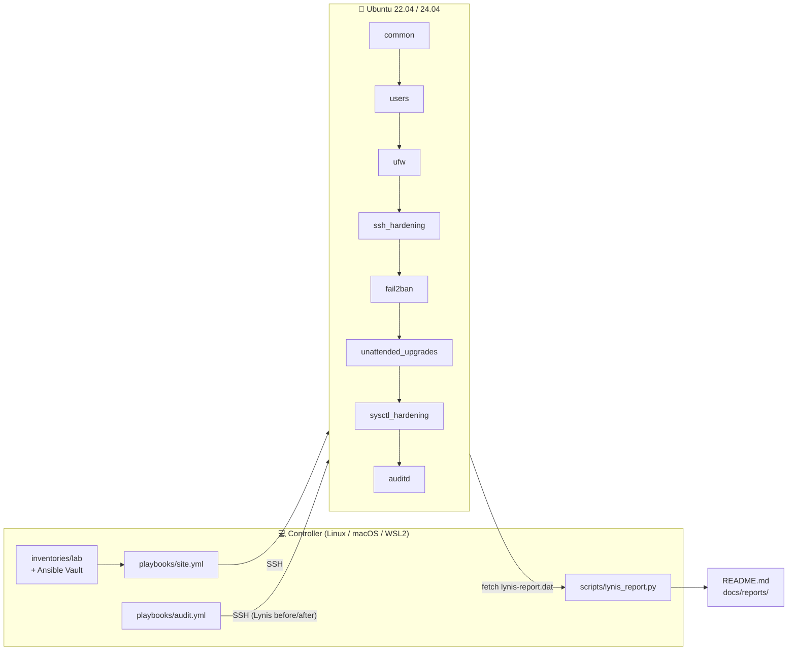
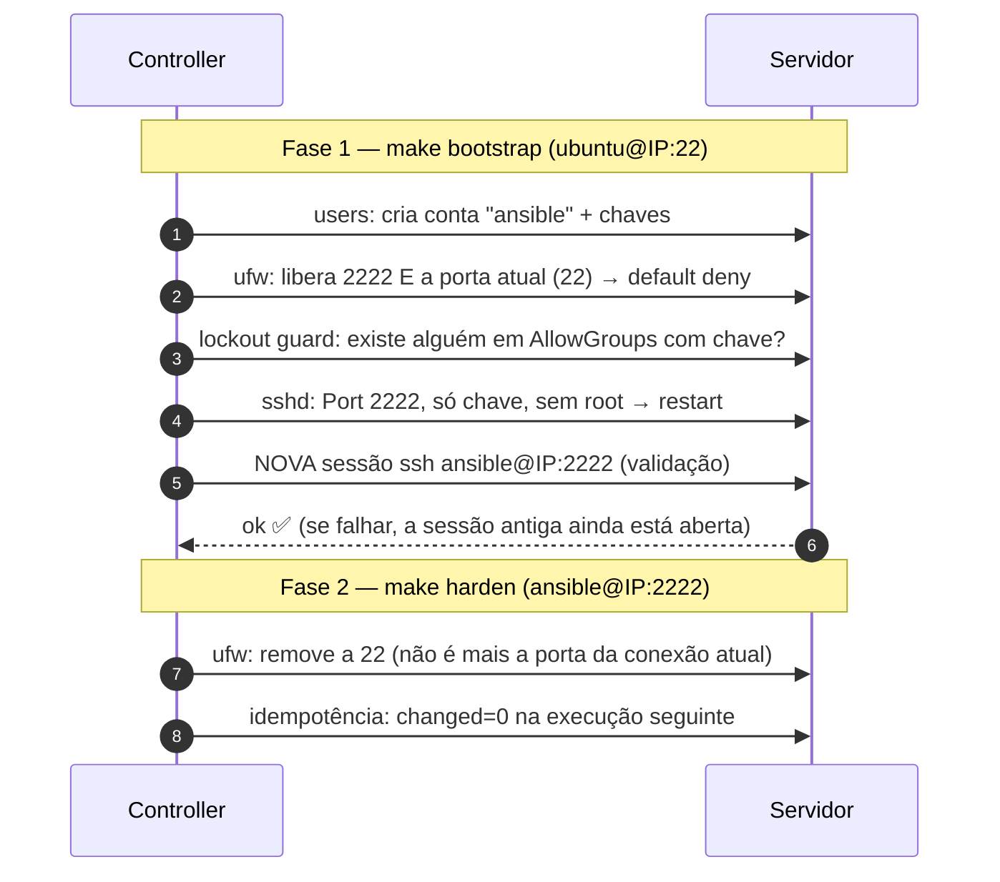

<div align="center">

# 🛡️ server-hardening-kit

**Hardening automatizado e mensurável de servidores Ubuntu com Ansible, mapeado ao CIS Benchmark.**

[](https://github.com/caiodassumpcao/server-hardening-kit/actions/workflows/ci.yml)
[](https://github.com/caiodassumpcao/server-hardening-kit/actions/workflows/e2e-lynis.yml)


[](LICENSE)

</div>

O kit pega um Ubuntu "de fábrica" e o leva a um baseline de segurança
**verificável**, com três garantias:

1. **Mede antes e depois.** O Lynis audita o servidor antes e depois do
   hardening, e o score é publicado neste README.
2. **Diz o que está fora do padrão sem mexer em nada.** No modo auditoria
   (`--check`) cada controle não conforme aparece como uma falha em relatório JUnit.
3. **Não te tranca fora do servidor.** A troca de porta do SSH é feita em duas
   fases, com *lockout guard* e validação de acesso a partir do controller.

---

## 🎯 Em 30 segundos

| | |
|---|---|
| **Problema** | Um Ubuntu recém-instalado aceita login por senha, não tem firewall nem auditoria. Endurecer na mão é lento, sujeito a erro e difícil de provar. |
| **Solução** | Um comando (`make harden`) aplica controles do **CIS Benchmark** em um ou vários servidores, de forma idempotente, e o **Lynis** mede o ganho de segurança antes/depois. |
| **Stack** | Ansible · Ubuntu 22.04/24.04 · Molecule + Docker · GitHub Actions · Python (pytest) · Lynis · UFW · fail2ban · auditd · AppArmor |
| **Qualidade** | ansible-lint perfil `production` com 0 falhas · Molecule passando em Ubuntu 22.04 e 24.04 (converge, idempotência e verify) · pytest · E2E com Lynis em VM real no CI |

**O que este projeto demonstra**

- **Infraestrutura como código:** 9 roles Ansible reutilizáveis, configuráveis por variáveis, com segredos no Ansible Vault.
- **Segurança aplicada:** cada controle é rastreável até o item do CIS, o teste do Lynis e a técnica do MITRE ATT&CK que ele mitiga ([matriz](docs/CIS_MAPPING.md), [modelo de ameaças](docs/THREAT_MODEL.md)).
- **Mudança segura em produção:** modo auditoria que só relata sem alterar nada, e troca de porta SSH em duas fases que não tranca o operador fora do servidor.
- **Testes de infraestrutura:** pirâmide completa (lint → unitário → integração em containers → E2E em VM) rodando no GitHub Actions.
- **Decisões documentadas:** cada trade-off registrado como ADR ([DECISIONS.md](docs/DECISIONS.md)).

**Início rápido** (detalhes no [passo a passo](#-passo-a-passo-do-clone-ao-servidor-endurecido)):

```bash
git clone https://github.com/caiodassumpcao/server-hardening-kit.git && cd server-hardening-kit
make install                 # virtualenv + Ansible + coleções
make lab-init                # cria seu inventário a partir do exemplo
make check                   # só audita: mostra o que está fora do padrão
make bootstrap && make harden # aplica o hardening
make test                    # (opcional) roda os testes Molecule localmente
```

---

## Sumário

- [Em 30 segundos](#-em-30-segundos)
- [Resultados](#-resultados)
- [O que é aplicado](#-o-que-é-aplicado)
- [Arquitetura](#-arquitetura)
- [Passo a passo: do clone ao servidor endurecido](#-passo-a-passo-do-clone-ao-servidor-endurecido)
  - [0. Pré-requisitos](#0-pré-requisitos)
  - [1. Clonar e preparar o ambiente](#1-clonar-e-preparar-o-ambiente)
  - [2. Criar uma chave SSH dedicada](#2-criar-uma-chave-ssh-dedicada)
  - [3. Provisionar o servidor alvo](#3-provisionar-o-servidor-alvo)
  - [4. Configurar o inventário](#4-configurar-o-inventário)
  - [5. Guardar segredos com Ansible Vault](#5-guardar-segredos-com-ansible-vault)
  - [6. Testar a conectividade](#6-testar-a-conectividade)
  - [7. Medir o baseline (Lynis "antes")](#7-medir-o-baseline-lynis-antes)
  - [8. Rodar o modo auditoria (`--check`)](#8-rodar-o-modo-auditoria---check)
  - [9. Aplicar o hardening (bootstrap)](#9-aplicar-o-hardening-bootstrap)
  - [10. Validar o acesso manualmente](#10-validar-o-acesso-manualmente)
  - [11. Segunda execução: steady state e idempotência](#11-segunda-execução-steady-state-e-idempotência)
  - [12. Reboot](#12-reboot)
  - [13. Medir o resultado (Lynis "depois") e publicar](#13-medir-o-resultado-lynis-depois-e-publicar)
- [Uso no dia a dia](#-uso-no-dia-a-dia)
- [Variáveis principais](#️-variáveis-principais)
- [Testes e CI](#-testes-e-ci)
- [Estrutura do repositório](#-estrutura-do-repositório)
- [Decisões de segurança e trade-offs](#️-decisões-de-segurança-e-trade-offs)
- [Recuperação de lockout](#-recuperação-de-lockout)
- [Troubleshooting](#-troubleshooting)
- [Roadmap](#️-roadmap)

---

## 📊 Resultados

Hardening index do Lynis antes e depois de `make bootstrap && make harden`. A
tabela é **gerada** pelo `make report` (seção 13), não escrita à mão. O mesmo
fluxo roda toda semana em VMs Ubuntu 22.04/24.04 no workflow
[E2E Lynis](.github/workflows/e2e-lynis.yml), e o resultado fica no *Summary* do job.

<!-- LYNIS:START -->
| Host | SO | Lynis | Score antes | Score depois | Δ | Warnings | Sugestões |
|---|---|---|:-:|:-:|:-:|:-:|:-:|
| _execute o passo a passo e rode `make report`_ | — | — | — | — | — | — | — |
<!-- LYNIS:END -->

Relatório detalhado (warnings e sugestões resolvidos e remanescentes):
[`docs/reports/lynis-comparison.md`](docs/reports/lynis-comparison.md).

> **Por que não 100?** Alguns testes do Lynis dependem de decisões de
> infraestrutura que um kit genérico não deve tomar sozinho (partições separadas,
> senha de GRUB, AIDE, antivírus). Estão listados em
> [Fora de escopo](docs/CIS_MAPPING.md#fora-de-escopo-decisão-consciente).

---

## ✅ O que é aplicado

| Role | O que faz | CIS (Ubuntu 24.04 v1.0.0) |
|---|---|---|
| [`common`](roles/common) | Valida o SO, espera o cloud-init, remove clientes legados (telnet/rsh/nis), desabilita módulos de kernel raros e USB storage, restringe core dumps, ativa AppArmor e banner | 1.1.1.x, 1.3, 1.5.3, 1.6, 2.2.x, 3.2.x |
| [`users`](roles/users) | Admins com sudo **com senha**, conta de automação só com chave, **sudo restrito** por allowlist de comandos, `su` bloqueado, `authorized_keys` exclusivo, auditoria de NOPASSWD | 5.2.1–5.2.7 |
| [`ufw`](roles/ufw) | Default deny, loopback anti-spoofing, rate limit no SSH, troca de porta sem lockout | 4.1.1–4.1.7 |
| [`ssh_hardening`](roles/ssh_hardening) | Só chave, sem root, porta configurável, `AllowGroups`, criptografia moderna (incl. KEX pós-quântico híbrido), moduli ≥ 3072 bits | 5.1.1–5.1.22 |
| [`fail2ban`](roles/fail2ban) | Jail `sshd` (aggressive, journald) com banimento progressivo + jail `recidive`, banindo via ufw | defesa em profundidade |
| [`unattended_upgrades`](roles/unattended_upgrades) | Patches **de segurança** automáticos, política explícita de reboot | 1.2.2.1 |
| [`sysctl_hardening`](roles/sysctl_hardening) | ASLR, ptrace, kptr/dmesg, BPF, redirects, rp_filter, SYN cookies… com **detecção de drift em runtime** | 1.5.1–1.5.3, 3.3.1–3.3.11 |
| [`auditd`](roles/auditd) | Todas as regras do CIS 6.2.3 geradas a partir de dados (multi-arquitetura), setuid descobertos no host, regras imutáveis, `audit=1` no boot | 6.2.1–6.2.3 |
| [`lynis`](roles/lynis) | Instala o Lynis do repositório oficial assinado, roda a auditoria e traz o relatório | — |

📋 **A matriz completa** (cada controle × item CIS × teste Lynis × técnica MITRE
ATT&CK × comando de verificação) está em
**[`docs/CIS_MAPPING.md`](docs/CIS_MAPPING.md)**.

---

## 🏗 Arquitetura



**A ordem das roles importa.** O `ufw` roda *antes* do `ssh_hardening`, então a
porta nova já está liberada quando o `sshd` reinicia. O `users` roda antes de
ambos, então já existe alguém com chave quando a senha é desligada.

### Migração de porta SSH em duas fases



Detalhes e alternativas consideradas: [ADR-004](docs/DECISIONS.md#adr-004--migração-de-porta-ssh-em-duas-fases-sem-lockout).

---

## 🚀 Passo a passo: do clone ao servidor endurecido

> ⏱️ Cerca de 30 minutos na primeira vez. Os comandos abaixo rodam no **controller**
> (sua máquina), exceto onde estiver indicado "no servidor".

### 0. Pré-requisitos

**Controller (onde o Ansible roda)**

| Item | Versão | Observação |
|---|---|---|
| Linux, macOS **ou Windows com WSL2** | — | O Ansible **não** roda nativamente no Windows |
| Python | 3.11+ | `python3 --version` |
| `git`, `make`, `ssh`, `openssl` | — | Já vêm no Ubuntu/WSL; no macOS, `xcode-select --install` |
| Docker | 24+ | **Só** para os testes com Molecule |

<details>
<summary><b>🪟 Usando Windows? Clique aqui</b></summary>

Use uma das duas opções:

**Opção 1: WSL2 (recomendado)**

```powershell
# PowerShell como administrador
wsl --install -d Ubuntu-24.04
```

Depois, dentro do Ubuntu (WSL):

```bash
sudo apt update && sudo apt install -y python3-venv python3-pip make git openssh-client
```

> ⚠️ **Clone o repositório dentro do filesystem do Linux (`~/`), não em
> `/mnt/c/...`.** Em `/mnt/c` todos os diretórios aparecem como *world-writable*,
> e por segurança o Ansible **ignora o `ansible.cfg`** do projeto (você verá o
> aviso `Ansible is being run in a world writable directory`). As chaves SSH
> também ficariam com permissões que o `ssh` recusa.

**Opção 2: Dev Container**

Com Docker Desktop e a extensão *Dev Containers* do VS Code, abra o projeto e
escolha **"Reopen in Container"**. O ambiente sobe com Ansible, Molecule e lint
instalados (ver [`.devcontainer/`](.devcontainer/devcontainer.json)).

</details>

**Servidor alvo**

| Item | Requisito |
|---|---|
| SO | Ubuntu Server **22.04** ou **24.04** LTS (x86_64 ou ARM64) |
| Acesso inicial | SSH por chave com um usuário que tenha sudo sem senha (`ubuntu` na AWS/Multipass) ou `root` (DigitalOcean/Hetzner) |
| Recursos | 1 vCPU, 1 GB RAM, 10 GB disco |
| Saída para internet | Para `apt` e para o repositório do Lynis |
| **Console de emergência** | Console web do provedor ou `multipass shell`, para o caso de lockout |

> 🚫 **Não use um servidor de produção como primeiro alvo.** Use uma VM descartável.

### 1. Clonar e preparar o ambiente

```bash
git clone https://github.com/caiodassumpcao/server-hardening-kit.git
cd server-hardening-kit

make install                 # cria .venv, instala ansible-core, ansible-lint, molecule e as coleções
source .venv/bin/activate    # ativa o ambiente (repita a cada novo terminal)

ansible --version            # deve mostrar ansible-core 2.17+ e o config file ./ansible.cfg
make help                    # lista todos os comandos
make test-unit               # sanity check: testes do gerador de relatório
```

<details>
<summary>O que o <code>make install</code> faz, passo a passo</summary>

```bash
python3 -m venv .venv
.venv/bin/pip install --upgrade pip
.venv/bin/pip install -r requirements.txt               # ferramentas Python
.venv/bin/ansible-galaxy collection install -r requirements.yml   # ansible.posix, community.general
```

</details>

### 2. Criar uma chave SSH dedicada

Uma chave só para o laboratório evita misturar acessos e facilita a rotação:

```bash
ssh-keygen -t ed25519 -f ~/.ssh/hardening_lab -C "hardening-lab"
ssh-add ~/.ssh/hardening_lab          # opcional: carrega no agente
cat ~/.ssh/hardening_lab.pub          # você vai colar isto no inventário
```

### 3. Provisionar o servidor alvo

Escolha **uma** opção.

#### Opção A: VPS na nuvem (recomendado; é o "deploy de verdade")

Crie uma VM **Ubuntu 24.04** em qualquer provedor e cadastre a chave
`~/.ssh/hardening_lab.pub` na criação.

| Provedor | Usuário inicial (`BOOTSTRAP_USER`) | Firewall do provedor |
|---|---|---|
| AWS EC2 / Lightsail | `ubuntu` | Security Group / aba Networking |
| Azure | definido na criação (ex.: `azureuser`) | Network Security Group |
| GCP | definido pela chave (ex.: `seu_usuario`) | VPC firewall rules |
| Oracle Cloud | `ubuntu` | Security List |
| DigitalOcean | `root` | Cloud Firewall (opcional) |
| Hetzner | `root` | Firewall (opcional) |

> ⚠️ **Antes do bootstrap, libere a porta TCP `2222` (e mantenha a `22`) no
> firewall do provedor.** O ufw controla o firewall *dentro* da VM; Security
> Groups e afins ficam *fora* dela. Se a 2222 estiver bloqueada no provedor, a
> validação pós-deploy falha (de propósito) e a porta 22 continua aberta para você
> corrigir.

#### Opção B: VM local com Multipass

[Multipass](https://multipass.run) roda no Windows, macOS e Linux:

```bash
cp lab/cloud-init.yml.example lab/cloud-init.yml
# edite lab/cloud-init.yml e cole sua chave pública (cat ~/.ssh/hardening_lab.pub)

multipass launch 24.04 --name hardening-lab --cpus 2 --memory 2G --disk 10G \
  --cloud-init lab/cloud-init.yml
multipass info hardening-lab | grep IPv4      # anote o IP
```

> 💡 **WSL2 + Multipass no Windows:** se o WSL não alcançar o IP da VM, ative o
> modo de rede espelhado criando `%UserProfile%\.wslconfig` com
> `[wsl2]` / `networkingMode=mirrored` e rode `wsl --shutdown`.

**Confirme o acesso inicial** (troque usuário e IP):

```bash
ssh -i ~/.ssh/hardening_lab ubuntu@203.0.113.10 'lsb_release -ds && sudo -n true && echo SUDO_OK'
```

### 4. Configurar o inventário

```bash
make lab-init      # copia inventories/example → inventories/lab (ignorado pelo Git)
```

Edite **`inventories/lab/hosts.yml`**:

```yaml
lab-01:
  ansible_host: 203.0.113.10                          # ← IP do servidor
# ...
ansible_ssh_private_key_file: ~/.ssh/hardening_lab    # ← descomente
```

Edite **`inventories/lab/group_vars/hardening/main.yml`**:

```yaml
hardening_ssh_port: 2222
hardening_trusted_networks: ["198.51.100.7/32"]   # seu IP público (curl -s ifconfig.me): nunca será banido

users_automation:
  enabled: true
  name: ansible
  ssh_keys:
    - "ssh-ed25519 AAAA... hardening-lab"          # ← conteúdo de ~/.ssh/hardening_lab.pub

users_admins:
  - name: caio                                     # ← seu usuário pessoal
    ssh_keys:
      - "ssh-ed25519 AAAA... hardening-lab"
    password_hash: "{{ vault_admin_password_hash }}"
```

> Por que duas contas? `ansible` é a **automação** (sudo sem senha, apenas chave).
> `caio` é o **humano** (sudo com senha, como pede o CIS). Ver
> [ADR-003](docs/DECISIONS.md#adr-003--conta-de-automação-com-nopasswd-exceção-ao-cis-524).

### 5. Guardar segredos com Ansible Vault

A senha do sudo do administrador vai para o inventário apenas como **hash**, e
o hash fica **criptografado**:

```bash
# 1) gere o hash SHA-512 da senha que você usará no sudo
openssl passwd -6
# Password: ********
# $6$Qx1...                                   ← copie

# 2) cole em inventories/lab/group_vars/hardening/vault.yml
#    vault_admin_password_hash: "$6$Qx1..."

# 3) crie a senha do cofre (arquivo ignorado pelo Git) e criptografe
read -rs -p "Senha do vault: " VP && echo "$VP" > .vault_pass && unset VP && chmod 600 .vault_pass
ansible-vault encrypt inventories/lab/group_vars/hardening/vault.yml

ansible-vault view inventories/lab/group_vars/hardening/vault.yml   # conferir
```

O `Makefile` passa `--vault-password-file .vault_pass` automaticamente quando o
arquivo existe.

### 6. Testar a conectividade

Antes do hardening o servidor ainda está "de fábrica", então usamos as
credenciais de **bootstrap** (`BOOTSTRAP=1`):

```bash
make ping BOOTSTRAP=1                         # AWS / Multipass (usuário ubuntu)
make ping BOOTSTRAP=1 BOOTSTRAP_USER=root     # DigitalOcean / Hetzner
```

Saída esperada: `lab-01 | SUCCESS => { "ping": "pong" }`.

### 7. Medir o baseline (Lynis "antes")

```bash
make audit-before BOOTSTRAP=1
```

O Lynis é instalado a partir do repositório oficial **assinado** da CISOfy, a
auditoria roda e o relatório é baixado para `reports/lab-01/before/`. Exemplo
de saída (o valor depende da imagem):

```
TASK [lynis : Show hardening index]
ok: [lab-01] => msg: 'Lynis hardening index (before) on lab-01: 61'
```

> `reports/` está no `.gitignore`: o relatório bruto contém hostname, IPs e a
> lista de pacotes do servidor. O que vai para o Git é só o resumo sanitizado.

### 8. Rodar o modo auditoria (`--check`)

Antes de alterar qualquer coisa, veja **o que** seria alterado:

```bash
make check BOOTSTRAP=1
```

- Nada é modificado no servidor (`--check`).
- Cada task reportada como **`changed`** é um controle **fora de conformidade**.
  O nome da task traz o ID do CIS (ex.: `CIS 5.1.20 | ...`).
- `--diff` mostra a linha exata que mudaria em cada arquivo.
- Um relatório **JUnit** é gerado em `reports/compliance/`. Cada controle não
  conforme vira um *test failure*, o que permite publicar o resultado no CI,
  em um dashboard ou anexar a uma evidência de auditoria.

```
TASK [ssh_hardening : CIS 5.1.x | Deploy hardened sshd drop-in (first match wins → 00- prefix)]
--- before
+++ after: /etc/ssh/sshd_config.d/00-hardening.conf
+Port 2222
+PermitRootLogin no
...
changed: [lab-01]
```

### 9. Aplicar o hardening (bootstrap)

> 💡 Deixe **outro terminal com uma sessão SSH aberta** no servidor durante a
> primeira execução. É uma boa prática em qualquer mudança de SSH ou firewall.

```bash
make bootstrap                          # usuário ubuntu, porta 22
make bootstrap BOOTSTRAP_USER=root      # DigitalOcean / Hetzner
```

O que acontece, na ordem:

1. **common**: valida o SO, espera o cloud-init, instala e remove pacotes,
   módulos de kernel, banners.
2. **users**: cria `sysadmins`, `sshusers` e `sugroup`, a conta `ansible`, o
   seu admin e as `authorized_keys`, além dos sudoers validados com `visudo`.
3. **ufw**: libera **2222 e 22**, aplica default deny e ativa o firewall.
4. **ssh_hardening**: verifica o *lockout guard*, aplica o drop-in validado
   com `sshd -t` e reinicia o `sshd`.
5. **fail2ban**, **unattended_upgrades**, **sysctl_hardening** e **auditd**.
6. **Validação**: o controller abre uma sessão **nova** com
   `ansible@IP -p 2222`. Se ela falhar, o playbook falha e a porta 22 continua aberta.

Final esperado (os números variam conforme a imagem):

```
PLAY RECAP *********************************************************************
lab-01   : ok=118  changed=61  unreachable=0  failed=0  skipped=9  rescued=0  ignored=0
TASK [Warn about pending reboot] ***********************************************
ok: [lab-01] => msg: Reboot required to activate kernel boot parameters / immutable audit rules...
```

### 10. Validar o acesso manualmente

```bash
IP=203.0.113.10; KEY=~/.ssh/hardening_lab

# ✅ conta de automação na porta nova
ssh -i $KEY -p 2222 ansible@$IP 'sudo -n true && echo "automação OK (sudo sem senha)"'

# ✅ seu admin: entra com chave, sudo PEDE senha
ssh -i $KEY -p 2222 caio@$IP 'sudo -k; sudo -v && echo "admin OK"'

# ❌ senha não é aceita, nem para usuário válido
ssh -p 2222 -o PubkeyAuthentication=no -o PreferredAuthentications=password caio@$IP
# → Permission denied (publickey).

# ❌ root não entra
ssh -i $KEY -p 2222 root@$IP
# → Permission denied (publickey).
```

**No servidor** (via `ssh -p 2222 caio@IP`):

```bash
sudo sshd -T | grep -E '^(port|permitrootlogin|passwordauthentication|allowgroups)'
sudo ufw status verbose
sudo fail2ban-client status sshd
sudo auditctl -s | grep enabled          # 2 = imutável (após o reboot, ver passo 12)
sudo sysctl net.ipv4.conf.all.log_martians kernel.yama.ptrace_scope
```

### 11. Segunda execução: steady state e idempotência

Agora o inventário "normal" (usuário `ansible`, porta 2222) passa a valer:

```bash
make harden
```

- A regra da **porta 22 é removida** do ufw, porque a conexão atual já usa a 2222.
- O `90-cloud-init-users` (NOPASSWD do usuário `ubuntu`) é removido.

Rode **mais uma vez**. O esperado é **`changed=0`**, ou seja, o playbook é
idempotente:

```bash
make harden
# lab-01 : ok=112  changed=0  unreachable=0  failed=0 ...
```

### 12. Reboot

O `audit=1` no kernel e as regras imutáveis do auditd só valem após o reboot:

```bash
make reboot
ssh -i ~/.ssh/hardening_lab -p 2222 caio@203.0.113.10 \
  'grep -o "audit=1" /proc/cmdline; sudo auditctl -s | grep enabled'
# audit=1
# enabled 2
```

### 13. Medir o resultado (Lynis "depois") e publicar

```bash
make audit-after          # → reports/lab-01/after/
make report               # compara, gera docs/reports/lynis-comparison.md e atualiza este README
```

```
wrote docs/reports/lynis-comparison.md
updated README.md
```

Confira a tabela na seção [Resultados](#-resultados) e faça o commit:

```bash
git add README.md docs/reports/lynis-comparison.md
git commit -m "docs: publish Lynis before/after results"
git push
```

🎉 **Pronto.** O servidor está endurecido, auditável e com o resultado medido.

---

## 🔁 Uso no dia a dia

| Objetivo | Comando |
|---|---|
| Ver todos os comandos | `make help` |
| Auditar sem alterar (drift) | `make check` |
| Aplicar em todos os hosts | `make harden` |
| Aplicar em um host só | `make harden LIMIT=lab-01` |
| Aplicar só uma área | `make harden TAGS=ssh` · `TAGS=ufw` · `TAGS=users` · `TAGS=auditd` |
| Ver o plano de uma área | `make check TAGS=sysctl` |
| Passar parâmetros extras ao Ansible | `make harden ARGS="-vvv"` |
| Auditoria Lynis avulsa | `make audit-after ARGS="-e lynis_label=2026-11-monthly"` |
| Reiniciar e esperar voltar | `make reboot` |

### Receitas

<details>
<summary><b>Adicionar um administrador</b></summary>

```yaml
# inventories/lab/group_vars/hardening/main.yml
users_admins:
  - name: maria
    comment: "Maria - SRE"
    ssh_keys: ["ssh-ed25519 AAAA... maria@notebook"]
    password_hash: "{{ vault_maria_password_hash }}"
```

```bash
ansible-vault edit inventories/lab/group_vars/hardening/vault.yml   # adicione vault_maria_password_hash
make harden TAGS=users
```

Para **revogar**, mova o nome para `users_absent: [maria]`. Como o
`authorized_keys` é **exclusivo**, remover uma chave da lista também a remove do
servidor.
</details>

<details>
<summary><b>Conta de deploy com sudo restrito</b></summary>

```yaml
users_restricted:
  - name: deployer
    ssh_keys: ["ssh-ed25519 AAAA... github-actions"]
    sudo_commands:
      - /usr/bin/systemctl restart myapp
      - /usr/bin/systemctl reload nginx
```

Resultado em `/etc/sudoers.d/30-hardening-restricted`:

```
Cmnd_Alias DEPLOYER_CMDS = /usr/bin/systemctl restart myapp, /usr/bin/systemctl reload nginx
deployer ALL=(root) NOPASSWD: DEPLOYER_CMDS
```
</details>

<details>
<summary><b>Abrir portas da aplicação</b></summary>

```yaml
ufw_rules:
  - { rule: allow, port: "80",   proto: tcp, comment: "http" }
  - { rule: allow, port: "443",  proto: tcp, comment: "https" }
  - { rule: allow, port: "9100", proto: tcp, from_ip: "10.0.0.0/8", comment: "node_exporter (rede interna)" }
```
</details>

<details>
<summary><b>Restringir SSH ao seu IP / VPN (maior ganho contra brute force)</b></summary>

```yaml
ufw_ssh_allowed_sources: ["198.51.100.7/32", "10.8.0.0/24"]
users_automation:
  allowed_from: ["198.51.100.7"]     # a chave da automação só funciona a partir daqui
```
</details>

<details>
<summary><b>Host com Docker / Kubernetes</b></summary>

```yaml
sysctl_hardening_ip_forward: true   # containers precisam de forwarding
ufw_default_routed: allow           # ou regras "route allow" específicas
```

> O Docker manipula o iptables diretamente e **ignora o ufw** para portas
> publicadas (`-p 8080:80`). Publique só em `127.0.0.1` ou use
> [ufw-docker](https://github.com/chaifeng/ufw-docker).
</details>

<details>
<summary><b>Detecção contínua de drift</b></summary>

Rode `make check` em um agendamento (cron no bastion, ou um workflow agendado com
runner self-hosted). Qualquer `changed` (ou *failure* no JUnit) significa que
alguém alterou o servidor fora do Ansible: um `sysctl -w`, uma chave SSH
adicionada à mão, um NOPASSWD "temporário".
</details>

---

## ⚙️ Variáveis principais

Todas as variáveis têm defaults seguros em `roles/<role>/defaults/main.yml`,
comentados com o item CIS correspondente. As mais usadas:

| Variável | Default | Descrição |
|---|---|---|
| `hardening_ssh_port` | `22` (exemplo usa `2222`) | Porta do SSH, compartilhada por `ssh_hardening`, `ufw` e `fail2ban` |
| `hardening_ssh_group` | `sshusers` | Único grupo autorizado no SSH (`AllowGroups`) |
| `hardening_admin_group` | `sysadmins` | Grupo com sudo completo (com senha) |
| `hardening_trusted_networks` | `[]` | IPs/CIDRs nunca banidos pelo fail2ban |
| `hardening_reboot` | `false` | Reinicia automaticamente quando necessário |
| `hardening_validate_ssh` | `true` | Validação pós-deploy de acesso na porta nova |
| `users_admins` | `[]` | Administradores humanos (`name`, `ssh_keys`, `password_hash`) |
| `users_automation` | desabilitado | Conta do Ansible (`enabled`, `name`, `ssh_keys`, `allowed_from`) |
| `users_restricted` | `[]` | Contas com sudo limitado (`sudo_commands`) |
| `users_absent` | `[]` | Contas a remover |
| `ssh_hardening_disable_forwarding` | `true` | Desliga túneis SSH (CIS 5.1.8) |
| `ufw_ssh_allowed_sources` | `[any]` | Origens permitidas no SSH |
| `ufw_ssh_rule` | `limit` | `limit` (rate limit) ou `allow` |
| `ufw_rules` | `[]` | Regras da aplicação |
| `fail2ban_bantime` / `fail2ban_sshd_maxretry` | `1h` / `3` | Política de banimento |
| `unattended_upgrades_automatic_reboot` | `false` | Reboot automático após patch de kernel |
| `sysctl_hardening_ip_forward` | `false` | `true` em hosts Docker/K8s/VPN |
| `sysctl_hardening_extra_params` | `[]` | Parâmetros extras ou overrides |
| `auditd_immutable` | `true` | Regras imutáveis até o reboot (CIS 6.2.3.20) |
| `auditd_conf` | valores CIS | Retenção e ações de disco cheio |
| `auditd_extra_rules` | `[]` | Regras adicionais (linhas `auditctl`) |
| `lynis_install_method` | `cisofy` | `cisofy` (repo oficial) ou `distro` |

---

## 🧪 Testes e CI

### Pirâmide de testes

| Camada | Ferramenta | Comando local | CI |
|---|---|---|---|
| Estática | `yamllint` + `ansible-lint` (perfil **production**) | `make lint` | todo push/PR |
| Unitária | `pytest` (gerador de relatório) | `make test-unit` | todo push/PR |
| Integração | **Molecule** + Docker: Ubuntu 22.04 **e** 24.04 com systemd | `make test` | todo push/PR (matriz) |
| Ponta a ponta | Playbook real + **Lynis** em VM do GitHub Actions | — | push na `main` + semanal |

### Molecule

O cenário em [`molecule/default/`](molecule/default) aplica o **mesmo**
`playbooks/site.yml` de produção e executa:

`create → prepare → converge → idempotence → verify → destroy`

- **idempotence**: a segunda execução precisa ter `changed=0`.
- **verify**: confere o **estado efetivo**, não apenas os arquivos. Exemplos:
  `sshd -T` (configuração que o sshd realmente carregou), `sudo -l -U deployer`
  (sudo restrito de fato), `apt-config dump` (se o `#clear` funcionou) e
  `fail2ban-client get sshd maxretry`.

```bash
make test                                 # Ubuntu 24.04 (padrão)
MOLECULE_DISTRO=ubuntu2204 make test      # Ubuntu 22.04

# Ciclo rápido de desenvolvimento
make converge          # aplica
.venv/bin/molecule login    # shell dentro do container
make verify            # só as asserções
make destroy
```

> Containers não têm auditd, GRUB nem netfilter próprios. No Molecule essas
> partes são verificadas **no nível de arquivo**, e o E2E as verifica **em
> comportamento real**.

### E2E com Lynis (`.github/workflows/e2e-lynis.yml`)

Usa o próprio runner do GitHub, uma VM Ubuntu descartável, como alvo:

1. Lynis **antes**
2. `site.yml` (hardening)
3. `site.yml` de novo, exigindo **`changed=0`** (idempotência em VM real)
4. `site.yml --check`, exigindo **`changed=0`** (o modo auditoria reconhece um host conforme)
5. Lynis **depois**, com a tabela comparativa publicada no **Job Summary** e os
   relatórios como *artifact*

Roda também **toda segunda-feira**, o que detecta regressões causadas por
atualizações do Ubuntu ou do Lynis sem nenhum commit no repositório.

### Pre-commit (opcional)

```bash
pip install pre-commit && pre-commit install
```

Roda yamllint, ansible-lint, `detect-private-key` e **gitleaks** antes de cada
commit, o que evita versionar segredos por engano.

---

## 📁 Estrutura do repositório

```
server-hardening-kit/
├── ansible.cfg                  # pipelining, ControlPersist, diff sempre ligado
├── Makefile                     # interface única: make help
├── requirements.txt / .yml      # ferramentas Python / coleções Ansible
├── playbooks/
│   ├── site.yml                 # hardening (enforce ou --check) + validação pós-deploy
│   └── audit.yml                # Lynis + coleta do relatório
├── roles/
│   ├── common/                  # baseline do SO
│   ├── users/                   # contas, sudo, su
│   ├── ufw/                     # firewall
│   ├── ssh_hardening/           # OpenSSH + lockout guard
│   ├── fail2ban/
│   ├── unattended_upgrades/
│   ├── sysctl_hardening/        # kernel + drift detection
│   ├── auditd/                  # regras CIS orientadas a dados
│   └── lynis/
├── inventories/example/         # modelo (inventories/<seu-ambiente>/ fica fora do Git)
├── molecule/default/            # testes de integração
├── tests/                       # pytest + inventário do E2E
├── scripts/lynis_report.py      # before/after → Markdown/README/CI gate
├── docs/
│   ├── CIS_MAPPING.md           # controle × CIS × Lynis × ATT&CK
│   ├── DECISIONS.md             # ADRs
│   ├── THREAT_MODEL.md          # STRIDE
│   └── reports/                 # resultados publicados
├── lab/cloud-init.yml.example   # VM local com Multipass
├── .github/workflows/           # CI + E2E
└── .devcontainer/               # ambiente pronto para Windows/macOS
```

---

## ⚖️ Decisões de segurança e trade-offs

Resumo; o raciocínio completo está em [`docs/DECISIONS.md`](docs/DECISIONS.md),
e o modelo de ameaças em [`docs/THREAT_MODEL.md`](docs/THREAT_MODEL.md).

| Decisão | Trade-off aceito |
|---|---|
| Drop-in `00-hardening.conf` em vez de reescrever `sshd_config` | Precisa entender a regra *first match wins* do sshd, mas sobrevive a upgrades e vence o `50-cloud-init.conf` |
| Socket activation do SSH desligado | Diverge do default do 24.04, mas usa um único caminho em 22.04/24.04 |
| Conta de automação `NOPASSWD` | Exceção ao CIS 5.2.4, mitigada com conta só por chave, `from=` e trilha no auditd |
| Migração de porta em duas fases | A porta 22 fica aberta até a 2ª execução, como rota de volta |
| auditd imutável + `single` em disco cheio | Integridade da trilha acima da disponibilidade; mudar regras exige reboot |
| Só patches de **segurança** automáticos, sem reboot automático | Kernel novo só ativa no próximo reboot planejado |
| Porta SSH não padrão | **Não** é controle de segurança, só reduz ruído de bots; os controles reais são chave, fail2ban, rate limit e `AllowGroups` |

---

## 🆘 Recuperação de lockout

Se, apesar das proteções, você perder o acesso:

1. Abra o **console fora de banda** (console web do provedor, `multipass shell
   hardening-lab`, serial console).
2. Desfaça só o necessário:

```bash
sudo rm /etc/ssh/sshd_config.d/00-hardening.conf   # volta o sshd ao padrão
sudo systemctl restart ssh
sudo ufw allow 22/tcp                              # reabre a 22
sudo fail2ban-client unban --all                   # remove banimentos
```

3. Corrija a causa (chave errada no inventário, porta bloqueada no provedor…) e
   rode `make bootstrap` de novo. O playbook é idempotente.

---

## 🔧 Troubleshooting

| Sintoma | Causa provável | Solução |
|---|---|---|
| `Ansible is being run in a world writable directory ... ignoring it as an ansible.cfg source` | Repositório em `/mnt/c` no WSL | Clone em `~/` dentro do WSL |
| `UNREACHABLE` / timeout na porta 2222 após o bootstrap | Firewall **do provedor** bloqueando a 2222 | Libere a 2222 no Security Group/Cloud Firewall; a 22 continua aberta |
| `LOCKOUT GUARD: no members in ['sshusers']` | Nenhum usuário com chave definido | Preencha `users_automation`/`users_admins` com `ssh_keys` |
| Falha em *Open a fresh SSH session as the steady-state user* | A chave do inventário não corresponde à sua chave privada | Confira `ansible_ssh_private_key_file` e `users_automation.ssh_keys` |
| `Permission denied (publickey)` no `make harden` | Ainda conectando com o usuário/porta do bootstrap | Pós-bootstrap use `make harden` **sem** `BOOTSTRAP=1` |
| Fui banido pelo fail2ban | Muitas tentativas a partir do seu IP | Pelo console: `sudo fail2ban-client set sshd unbanip SEU_IP`; adicione o IP em `hardening_trusted_networks` |
| `Could not get lock /var/lib/dpkg/lock-frontend` | apt/cloud-init de primeiro boot | O kit já espera até 600s; aumente `hardening_apt_lock_timeout` se preciso |
| Docker/containers sem rede após o hardening | `ip_forward=0` | `sysctl_hardening_ip_forward: true` |
| Handler avisa "audit rules are immutable" | `-e 2` já carregado | Esperado: `make reboot` para aplicar as novas regras |
| `sudo` pede senha e você não sabe qual é | Admin sem `password_hash` | Defina o hash no vault (passo 5) e rode `make harden TAGS=users` |
| Molecule falha ao subir o container | Docker sem suporte a cgroup v2/systemd | Use Docker Engine recente (Linux/WSL2) ou o Dev Container |
| `make check` mostra `changed` em host já endurecido | **Drift**: alguém alterou o servidor | Leia o `--diff`; rode `make harden` para reconciliar |

---

## 🗺️ Roadmap

- [ ] Ubuntu 26.04 LTS: validar compatibilidade com `sudo-rs`/`uutils`, adotados por padrão a partir do 25.10
- [ ] AIDE (integridade de arquivos, CIS 6.3) com baseline e relatório de diferenças
- [ ] Envio de logs (journald/auditd) para SIEM remoto
- [ ] Certificados SSH (OpenSSH CA) em vez de `authorized_keys`
- [ ] Comparação com OpenSCAP / CIS-CAT para validação cruzada do score
- [ ] Laboratório reproduzível com Terraform (VPS + firewall do provedor)
- [ ] README em inglês

---

## 📄 Licença

[MIT](LICENSE). Use, adapte e contribua.

> ⚠️ **Aviso:** este kit altera configurações críticas de acesso. Teste em
> ambiente descartável, rode `make check` antes de `make harden` e mantenha
> acesso fora de banda. O uso em produção é de responsabilidade de quem o executa.
